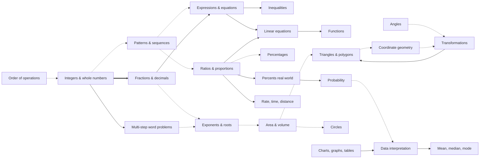

# Postojeći prostori znanja / grafovi preduslova za ELA i Math

**Pitanje (od mentora):** da li već postoji gotov graf (prostor znanja) koji mogu da iskoristim za teme iz My Smart Mentor-a (9 grupa, 40 tema, ELA + Math, SHSAT nivo)?
**Istraženo:** 2026-11-14 · Izvore za početak je predložio kolega: Learning Commons i Coherence Map.
## Kratak odgovor

- **Math: DA, delimično.** Postoji otvoren graf preduslova između standarda (Coherence Map) koji pokriva skoro sve moje math teme. Mogu da ga preuzmem i iskoristim kao **polaznu verziju** prostora znanja. Ekspert onda ne kreće od nule, nego samo pregleda i ispravlja.
- **ELA: NE.** Nisam našao gotov graf preduslova za ELA (razumevanje teksta, gramatiku, revidiranje) koji bi bio otvoren i u formatu za upotrebu. Postoje samo **spiskovi veština po razredima** (standardi), ali bez veza među veštinama. Za ELA graf mora da napravi ekspert (ili ja uz pomoć LLM-a, pa ekspert da potvrdi).
- **Nijedan izvor nije KST prostor znanja u užem smislu.** To su grafovi preduslova. Iz njih se prostor znanja **izvodi**: kada se relacija preduslova uzme kao surmise relacija, dobija se prostor znanja (Doignon & Falmagne).

## 1. Learning Commons Knowledge Graph ⭐ (glavni izvor)

**Šta je:** otvorena baza obrazovnih podataka (Learning Commons, v1.17.0 od 10. 11. 2026). U njoj su standardi za sve američke savezne države, „learning components“ (sitne veštine), kurikulum Illustrative Mathematics, Eedi misconceptions i drugo. Licenca je **CC BY 4.0**, a podaci o progresiji su dobijeni pod CC0 od Student Achievement Partners. Ceo export (`nodes.jsonl` + `relationships.jsonl`, ~1 GB) preuzeo sam **bez naloga**. Postoje i REST API i MCP server, ali za njih treba API ključ.

**Šta sam zatekao kad sam preuzeo i prebrojao podatke:**

| Deo | Šta je | Koristi mi? |
|---|---|---|
| **Math Coherence Map** | 406 CCSS math standarda (K–12), **757 usmerenih veza `buildsTowards`** („ako ne zna A, verovatno neće moći B“) i 284 zapisa `relatesTo` (to je **142 neusmerena para**, jer je svaki par zapisan u oba smera) | ✅ **Da, to je graf preduslova** |
| Math learning components | ~sitne veštine (Achievement Network) povezane sa standardima (`supports`) | 🟡 kao opis/podčvorovi, **nemaju veze preduslova među sobom** |
| ELA learning components | samo **K–2** (Common Core + 12 država) | ❌ prenizak nivo za SHSAT |
| Eedi Misconceptions Graph | 2.258 math „konstrukata“ i 8.117 tipičnih zabluda (`hinders`) | 🟡 za objašnjavanje **pogrešnih odgovora**, nema preduslova |
| New Meridian mastery statistics | pragovi savladanosti po standardu (math 3–8) | 🟡 možda kasnije za pravilo „naučeno je“ |
| Standardi New York Next Generation (Math i ELA) + crosswalk ka CCSS | NY standardi su ono na čemu se zasniva SHSAT | ✅ za mapiranje SHSAT → CCSS → Coherence Map |
| ELA progresije | **ne postoje** (jedini dataset progresija je Math Coherence Map) | ❌ |

**Licenca u praksi:** CC BY 4.0 dozvoljava i komercijalnu upotrebu (My Smart Mentor), uz navođenje izvora. Tekst za navođenje je u samim podacima: *„Knowledge Graph is provided by Learning Commons under the CC BY-4.0 license. Learning Commons received learning progressions under CC0 from Student Achievement Partners.“*

**Bitan detalj:** `buildsTowards` je definisan kao *„proficiency in one entity supports the likelihood of success in another … without requiring strict prerequisite order“*. To je **mekši** pojam od strogog KST preduslova. Za KST ga tretiram kao preduslov, ali to treba napisati kao pretpostavku.

## 2. Coherence Map (Achieve the Core / Student Achievement Partners)

- Interaktivni alat na [achievethecore.org/coherence-map](https://achievethecore.org/coherence-map/) koji prikazuje veze među Common Core math standardima (K–8 + „široko primenljivi preduslovi“ za srednju školu). Uz svaki standard idu primer zadatka i izvodi iz *Progressions* dokumenata.
- **Nema izvoza podataka ni API-ja** na samom sajtu. Isti podaci su u Learning Commons-u (gore), pa koristim njih.
- **Ne postoji ELA verzija.**

Zaključak: kolega je predložio dva izvora, ali je to praktično **jedan graf**. Coherence Map je original, a Learning Commons ga nudi u mašinski čitljivom obliku.

## 3. Šta sam uradio sa Coherence Map-om

Skripta: [skripte/coherence_map.py](skripte/coherence_map.py) · Izlaz: [podaci/coherence-map-teme.json](podaci/coherence-map-teme.json)

1. Iz exporta sam izvukao svih 406 standarda i 1.041 vezu.
2. Ručno sam mapirao standarde za razrede 3–8 na math teme iz My Smart Mentor-a (**to mapiranje je moja procena**, ekspert treba da ga proveri). Mapirano je **185 standarda**.
3. Sabrao sam veze između standarda u veze između tema.

**Šta sam saznao:**
- **Na nivou standarda graf je aciklički (DAG)**, pa se direktno može koristiti kao surmise relacija u KST-u. U opsegu SHSAT-a (razredi 4–8, samo mapirani standardi) to je **160 čvorova i 253 veze**. Bez ijedne veze ostaje 11 standarda.
- **Na nivou mojih tema pojavljuju se ciklusi.** Primeri: `integers ⇄ fractions` (28 veza u jednom smeru, 9 u drugom) i krug u geometriji `coordinate → transformations → triangles → coordinate`. Razlog je što su teme **preširoke**: „Integers and whole numbers“ obuhvata i množenje iz 3. razreda i operacije sa racionalnim brojevima iz 7. razreda.
- **Pokrivenost tema je neujednačena.** Fractions (29 standarda) i integers (40) su detaljno pokriveni. Percentages, circles, mean/median/mode, rate-time-distance i percents real-world imaju po **jedan** standard. **Logic and reasoning problems nema nijedan**, jer u CCSS-u to su „mathematical practices“, a za njih Coherence Map nema veza.

**Nacrt grafa tema** (veze u većinskom smeru, bez tranzitivnih; isprekidana linija = samo jedna veza u podacima, slab dokaz):

Graf je samo **ilustracija**. Neke veze su logične (`expressions → linear equations → functions`, `ratios → percents/rate`). Neke su artefakt grubih tema (`percents real world → probability` dolazi od 7.RP.A.3 → 7.SP.C.x). Krug u geometriji pokazuje da teme ne mogu direktno da budu KST čvorovi.

## 4. ELA: šta postoji

- **CCSS ELA i NY Next Gen ELA standardi** (u Learning Commons-u, razredi K–12). Moje ELA teme se lepo mapiraju na standarde (procena):

  | Tema | CCSS (npr. 7. razred) |
  |---|---|
  | Main idea | RI/RL.7.2 |
  | Inference, Evidence | RI/RL.7.1 |
  | Vocabulary in context | L.7.4, RI/RL.7.4 |
  | Cause and effect | RI.7.3, RL.7.3 |
  | Text structure | RI.7.5 |
  | Author's purpose / point of view | RI.7.6, RL.7.6 |
  | Compare and contrast | RI/RL.7.9 |
  | Fiction vs nonfiction | RL (književni) vs RI (informativni) |
  | Grammar & usage, Sentence structure | L.7.1 |
  | Punctuation | L.7.2 |
  | Word choice / clarity, Combining sentences | L.7.3, W.7.5 |
  | Paragraph organization and flow | W.7.2 (organizacija, prelazi), W.7.4, W.7.5 |

- **Jedina „progresija“ u ELA standardima je vertikalna:** ista veština raste kroz razrede (RI.6.2 → RI.7.2 → RI.8.2). **Veza između različitih veština** (npr. „evidence je preduslov za inference“) **ne postoji ni u jednom izvoru koji sam našao.**
- U CCSS-u postoji i tabela *Language Progressive Skills*: gramatička pravila koja se uvode u nižem razredu, a moraju da se drže i dalje. To je mala, ali zvanična progresija za Grammar/Punctuation. Nisam je proverio u podacima, pa treba da se potvrdi u CCSS ELA dodatku.
- U literaturi o čitanju **hijerarhija veština razumevanja je sporna**: veštine su jako korelisane i nije jasno da li se uče redom. To je bitno za rad, jer ELA graf možda ne može da bude strog kao math graf.
- **Prirodan polazni redosled** već postoji u mojim tipovima praznina (gap types): *detalj → zaključivanje (inference) → sinteza (main idea, tone)*. To odgovara poznatoj podeli razumevanja na doslovno, inferencijalno i evaluativno, pa može da bude ekspertska hipoteza za ELA graf.

## 5. Ostali gotovi grafovi koje sam proverio

| Izvor | Šta ima | Zašto (ne) |
|---|---|---|
| **ALEKS** | pravi KST prostori znanja za math | ❌ zatvoren, komercijalan |
| **Dynamic Learning Maps** (Univ. of Kansas) | velike mape učenja za ELA i Math (hiljade čvorova i veza) | ❌ namenjene učenicima sa teškoćama u razvoju, nisam našao javno preuzimanje. Zanimljivo jer imaju i **ELA** mapu |
| **Junyi Academy dataset** | ~700–1.300 math vežbi sa poljem `prerequisite` (stablo znanja) | 🟡 otvoren za istraživanje, ali **nije za komercijalnu upotrebu** i sledi tajvanski kurikulum |
| **Tatsuoka fraction subtraction** (R paketi CDM, GDINA) | 20 zadataka × 8 veština (Q-matrica), 536 učenika | 🟡 klasičan mali primer za **razlomke**, dobar za testiranje KST koda i simulaciju |

## 6. ELA: SHSAT, slični testovi i zatvoreni izvori (za ideje)

Dopuna od 2026-11-15. Ni ovde nema gotovog grafa, ali ima materijala za **ideje**:

| Izvor | Otvoreno? | Šta daje |
|---|---|---|
| **NYC DOE SHSAT vodič** (handbook / prep guide) | ✅ besplatan PDF | Zvaničan opis sadržaja: Revising/Editing (organizacija, rtanazvoj teme, struktura rečenice, interpunkcija, upotreba) + Reading Comprehension. Pija su usklađena sa **NY Next Gen ELA standardima**. Ima primere testova. Grafa nema. |
| **College Board SAT Suite / PSAT 8/9** + *Skills Insight* | ✅ javno | PSAT 8/9 je nivo najbliži SHSAT-u. 4 domena: Information and Ideas, Craft and Structure, Expression of Ideas, Standard English Conventions. Veštine (po mom znanju, iz PDF-a nisam uspeo da potvrdim nazive): Central Ideas and Details, Command of Evidence, Inferences, Words in Context, Text Structure and Purpose, Cross-Text Connections, Rhetorical Synthesis, Transitions, Boundaries, Form/Structure/Sense. To se **skoro 1:1 poklapa sa mojim ELA temama**. Skills Insight opisuje šta učenik zna u **7 bendova skora**, i opisi su kumulativni. To je **progresija po težini unutar veštine**, a ne preduslov između veština. |
| **NYS Grades 3–8 ELA released questions** (2025) | ✅ besplatno | Prava pitanja za 7. i 8. razred, svako vezano za standard. Dobro za primere i mapiranje, ali procenat tačnih odgovora po pitanju nisam našao. |
| **Renaissance Star – Core Progress** | ❌ zatvoreno (samo za korisnike) | Tvrde da imaju „mrežu preduslova“ za čitanje (470+ veština). Lista nije javna, ali **potvrđuje da je ideja ELA grafa preduslova izvodljiva u praksi**. |
| **ETS CBAL learning progressions** | ✅ javni izveštaji | Nivoi razvoja za argumentaciju (i druge ELA prakse), označeni kao privremeni modeli. Opet progresija **unutar** veštine. |
| **Quantile Framework** (math) | 🟡 besplatno uz registraciju | Za svaku math veštinu prikazuje *Prerequisite / Supporting / Impending*. Korisno za **proveru** veza iz Coherence Map-a. |

**Ideja za ELA graf iz ovoga:** svi ELA izvori opisuju **nivoe unutar veštine**, a ne veze između veština. Zato ELA čvor može da bude **veština × nivo** (npr. Main idea 1/2/3, nivoi preuzeti iz Skills Insight bendova ili iz razreda 6/7/8 u standardima). Preduslov je niži nivo iste veštine, plus nekoliko ekspertskih veza između veština (detalj → inference → sinteza; grammar → sentence structure → combining sentences).

## 7. Math: koliko čvorova

406 je ceo graf (K–12). Opcije (izračunato iz [podaci/coherence-map-teme.json](podaci/coherence-map-teme.json)):

| Opseg | Čvorova | Veza |
|---|---|---|
| razredi 4–8 | 160 | 253 |
| razredi 4–8, podstandardi (6.RP.A.3.a, .b…) spojeni | 132 | 217 |
| razredi 5–8 | 128 | 186 |
| razredi 5–8, podstandardi spojeni | 106 | 161 |
| razredi 6–8 | 101 | 128 |
| razredi 6–8, podstandardi spojeni | 81 | 108 |

**Pažnja kod spajanja:** neke teme postoje samo kao podstandard (Percentages = 6.RP.A.3.c, Rate/time/distance = 6.RP.A.3.b). Ako se spoje, te teme nestaju. Tako da ih ostavljam odvojeno. Razred 5 ne bih bacao, jer su tu razlomci (u 6–8 ostaju samo 2 čvora za Fractions).

**Preporuka:** razredi 5–8, spojeni podstandardi osim onih koji su sami tema → **~110 čvorova**. Za studiju slučaja može i manje: jedna ili dve grupe (npr. Arithmetic + Algebra, ~50 čvorova), da ekspert stigne sve da pregleda.

## Zaključak i sledeći koraci

1. **Math:** uzimam Coherence Map iz Learning Commons-a kao polazni graf. KST čvorovi su standardi (razredi ~5–8), a teme iz My Smart Mentor-a su grupe. Ekspert proverava mapiranje standard → tema i briše ili dodaje veze.
2. **ELA:** pravim graf sam (ili uz LLM): čvorovi su moje ELA teme, ili tema × nivo težine, a polazna hipoteza je *detalj → inference → sinteza* i vertikalna progresija iz standarda. Ekspert potvrđuje. To treba da bude jasno napisano kao ograničenje u radu.
3. Proveriti preko NY crosswalk-a da li se 45 dijagnostičkih pitanja mogu vezati za standarde. Ako mogu, dijagnostika direktno daje početno stanje u KST-u.
4. Pitanje za mentora: da li je prihvatljivo da je deo grafa preuzet (Coherence Map), a deo napravljen ručno (ELA)?
